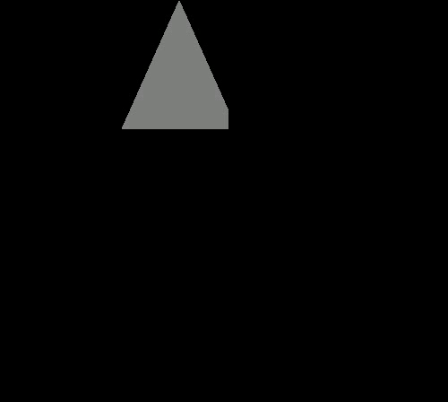
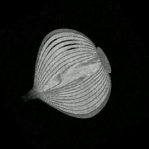

# Plane Projection

[](https://github.com/ofeq-dev/plane-projection/actions/workflows/ci.yml)
[](https://www.python.org/)
[](LICENSE)
[](https://ofeq-dev.github.io/plane-projection/)

Render any planar cross-section of a 3D voxel volume as a video: one NRRD
volume + one CSV plane-list → one `.mp4`, one frame per plane, in list order.

**Live demo & interactive walkthrough:** <https://ofeq-dev.github.io/plane-projection/>



## The problem

> Given a 3D raster matrix `M` and a plane `p`, compute the 2D image of the
> projection of `M` onto `p`.
>
> — `I2SE_Exe1.docx` (exercise brief, repo root)

A plane arrives as 3 or 4 points in a CSV row:

| Points | Geometry | Validity rule (with `EPS = 0.001`) |
|---:|---|---|
| 3 | isosceles triangle `(a, b, c)` | `|dist(a,b) − dist(a,c)| < EPS` |
| 4 | isosceles trapezoid `(a1, a2, b, c)` | `|dist(a1,b) − dist(a2,c)| < EPS`, `dist(a1,a2) ≤ dist(b,c)`, both legs on one plane |

An invalid row raises internally and becomes a **black error frame** with a red
banner naming the row and the failing rule; the remaining rows still render, so
one bad plane never kills the run. Each sample picks the **closest voxel**
(nearest-neighbour, half-to-even tie-break) — no interpolation or
"super-resolution", per the brief's Q&A. Samples outside `M` are black.

Requirements, acceptance criteria and the exact frame geometry live in
[`docs/srs.md`](docs/srs.md) and [`docs/algorithm.md`](docs/algorithm.md);
terms are defined in [`GLOSSARY.md`](GLOSSARY.md).

## Scope

**In scope:** NRRD volume input, CSV plane-list input, per-plane rendering,
per-row validation and error frames, MP4 output, a documented runtime budget,
and a CLI with the brief's exact call signature.

**Out of scope:** interactive/guided use, world-space (physically scaled)
rendering (voxel-index space only — [ADR 0002](docs/adr/0002-canonical-voxel-index-space.md)),
and out-of-plane interpolation ([rationale](docs/srs.md#12-scope)).

## Quick start

Python ≥ 3.12 (numpy 2.5.x requires it). Video encoding uses OpenCV's
`cv2.VideoWriter` with the `mp4v` codec — everything is pip-installable, no
system binary needed ([ADR 0004](docs/adr/0004-video-encoding-via-opencv-mp4v.md)).

> Large assets (`.nrrd` volumes, `.mp4` outputs) are stored in Git LFS — clone
> normally, then run `git lfs pull` to fetch the real files (see
> [`assets/nrrd/`](assets/nrrd/) and [`assets/videos/`](assets/videos/)).

```sh
git clone https://github.com/ofeq-dev/plane-projection.git
cd plane-projection
git lfs pull
python -m venv .venv && . .venv/bin/activate
pip install -r requirements.txt
# development extras (tests, typechecking):
pip install -r requirements-dev.txt
```

Run the brief's demo contract ([SRS FR-1](docs/srs.md)):

```sh
python Ex0.py file.nrrd file.csv file.mp4

# the lecturer's example: 2 valid planes + 2 deliberately invalid ones
python Ex0.py assets/nrrd/MRHead_1.nrrd assets/csv/lecturer_example.csv out.mp4
```

```
row 1: ok (triangle)
row 2: ok (trapezoid)
wrote 4 frames (500x448, mp4v @30 fps) to 'out.mp4' (2 error row(s))
```

Exit code is non-zero on usage errors (missing file, wrong argument count),
never because an individual plane is invalid — an invalid plane is reported on
stderr and in the video.

### Input CSV format

One header row, then one row per plane; the 4th point's cells are empty for
3-point rows:

```csv
Number of Points (3 or 4),x1,y1,z1,x2,y2,z2,x3,y3,z3,x4,y4,z4
3,200,200,0,0,200,400,400,200,400,,,
4,200,0,0,200,0,500,200,400,0,200,400,500
```

Coordinates are voxel indices into `M[x][y][z]`.

## Testing

```sh
python -m pytest        # 123 tests, ~10 s
```

The suite decodes the produced MP4 and compares rendered frames against
hand-derived pixel tables and committed goldens; it covers validation, error
frames, dtype scaling, canvas/padding, the CLI contract, and the benchmark
harness. Seams, oracles and the golden protocol are documented in
[`docs/testing-strategy.md`](docs/testing-strategy.md).

## Performance

The brief asks for **≥ 30 FPS** (target 100 FPS) on a 500³ byte volume.
Measured end-to-end (load + render, min-of-repeats) on the reference machine:

| Input | Frames | FPS |
|---|---:|---:|
| `croissant.nrrd` × `croissant.csv` — 500³ uint8, the canonical 500³ case | 100 | **43.6** |
| `onion.nrrd` × `head.csv` | 280 | 382.0 |
| `MRHead_1.nrrd` × `head.csv` | 280 | 381.3 |

The ≥ 30 FPS hard bar is met; the 100 FPS aspirational target is not met on
this (2013 dual-core) machine. Every row of the full 30-case cross-product —
with the exact one-line command that reproduced it — is in
[`benchmarks/results-2026-11-06.md`](benchmarks/results-2026-11-06.md).
Reproduce with:

```sh
python bench.py assets/nrrd/croissant.nrrd assets/csv/croissant.csv --repeats 3
python bench.py --corpus --repeats 3 --out benchmarks/results-$(date +%F).md
```

## Example runs & outputs

| Video | Volume / planes | What it shows |
|---|---|---|
| [`lecturer_example.mp4`](assets/videos/lecturer_example.mp4) | `MRHead_1` × `lecturer_example.csv` | The brief's demo: 2 projections + 2 error frames |
| [`head.mp4`](assets/videos/head.mp4) | `MRHead_1` × `head.csv` | 280 axial slices, black outside the volume |
| [`onion.mp4`](assets/videos/onion.mp4) | `onion` (uint8) | 120 frames with real texture |

`MRHead_1.nrrd` is `int16`; frames are shown over the full dtype range (no
content stretch), so in-volume samples are mid-gray and the projection is
visible as the gray/black boundary. A uint8 volume (`onion`) has full contrast:



Frame-by-frame commentary, canvas sizing and byte-identical reproducibility
notes: [`docs/example-run.md`](docs/example-run.md).

## Docs

| Document | Contents |
|---|---|
| [`docs/srs.md`](docs/srs.md) | Requirements (FR-1…FR-21, NFR-1…NFR-4), scope, acceptance criteria |
| [`docs/algorithm.md`](docs/algorithm.md) | Frame geometry, sampling, rounding and orientation |
| [`docs/algorithm.html`](docs/algorithm.html) | Interactive, plain-words walkthrough of the algorithm |
| [`docs/testing-strategy.md`](docs/testing-strategy.md) | Seams, oracles, goldens, traceability to requirements |
| [`docs/example-run.md`](docs/example-run.md) | A real run, frame by frame, with exported videos |
| [`docs/adr/`](docs/adr/) | Architecture decision records |
| [`docs/research/`](docs/research/) | Verified research notes (formats, primitives, perf testing) |
| [`benchmarks/`](benchmarks/) | Benchmark harness results |

## Repository layout

```
Ex0.py                    CLI + loader + validation + renderer + writer (single-file deliverable)
bench.py                  Benchmark harness (corpus cross-product, min-of-repeats)
tests/                    pytest suite (unit, golden, CLI/MP4, benchmark)
assets/nrrd|csv|videos/   Sample volumes, plane lists and rendered outputs (Git LFS for large files)
docs/                     SRS, algorithm, testing strategy, example run, ADRs, research
site/                     Static GitHub Pages demo (deployed on master)
```

## License

[MIT](LICENSE) — © 2026 Josh Hall (ofeq-dev). Sample NRRD volumes retain their
original provenance; see [`assets/nrrd/`](assets/nrrd/) for details.
