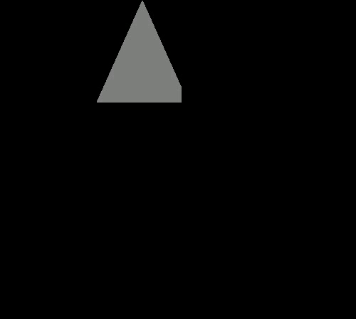
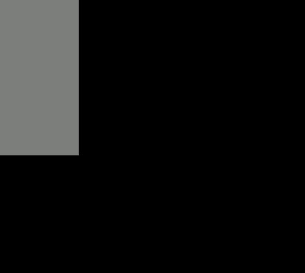
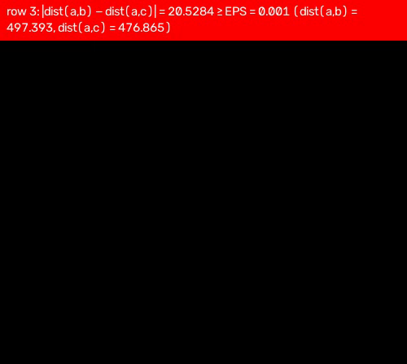
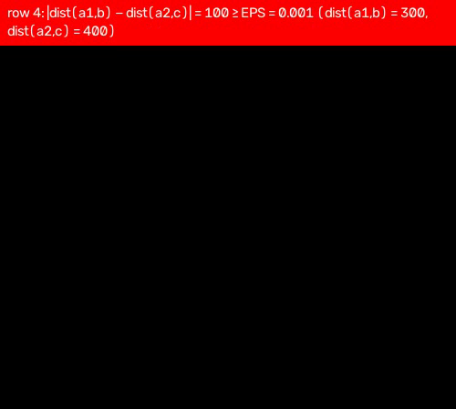
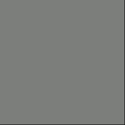
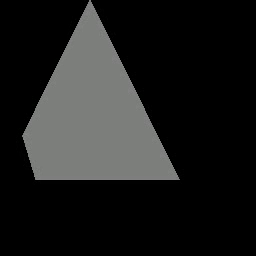
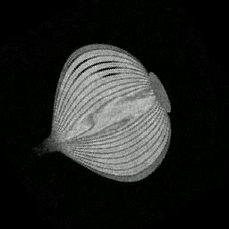

# Example run

A walk-through of the brief's demo command on the provided corpus, with the
output videos committed under [`assets/videos/`](../assets/videos/) (Git LFS,
[ADR 0001](adr/0001-store-volume-and-video-assets-in-git-lfs.md)). This is
the write-up AGENTS.md TODO #4 asks for and the evidence behind SRS §5.3.1
and §5.3.2.

## Environment

| | |
|---|---|
| Machine | Intel Core i7-4650U @ 1.70 GHz, 2 cores / 4 hardware threads |
| OS | Linux |
| Python | 3.12.15 |
| numpy | 2.5.4 |
| pynrrd | 1.1.3 |
| OpenCV | 5.0.0 (`mp4v`) |

Setup and dependencies: see the README's *Build & run* section.

## 1. The brief's demo command (SRS §5.3.1)

```sh
python Ex0.py assets/nrrd/MRHead_1.nrrd assets/csv/lecturer_example.csv assets/videos/lecturer_example.mp4
```

stdout:

```text
row 1: ok (triangle)
row 2: ok (trapezoid)
wrote 4 frames (500x448, mp4v @30 fps) to 'assets/videos/lecturer_example.mp4' (2 error row(s))
```

stderr (the invalid rows; identical text to each frame's banner):

```text
row 3: |dist(a,b) − dist(a,c)| = 20.5284 ≥ EPS = 0.001 (dist(a,b) = 497.393, dist(a,c) = 476.865)
row 4: |dist(a1,b) − dist(a2,c)| = 100 ≥ EPS = 0.001 (dist(a1,b) = 300, dist(a2,c) = 400)
```

The CSV has four rows; the video has four frames in row order:

| Row | Input | Verdict | Frame | What the frame shows |
|---:|---|---|---|---|
| 1 | 3-point, legs 447.21 | valid (triangle) | 400×447 | Only the part of the triangle inside the volume is non-black (the plane leaves the volume in x and z); the rest is black (FR-12d) |
| 2 | 4-point, legs 400/400, bases 500/500 | valid (rectangle) | 500×400 | Rectangle extends past the volume; the in-volume overlap is a 129×255 gray block, everything else black |
| 3 | 3-point, distances 497.393 vs 476.865 | **error** | `PlaneError` → error frame | `|dist(a,b) − dist(a,c)| = 20.5284`, far above EPS = 0.001 |
| 4 | 4-point, legs 300 vs 400 | **error** | `PlaneError` → error frame | `|dist(a1,b) − dist(a2,c)| = 100`, far above EPS = 0.001 |

The two valid frames (extracted from the mp4, not re-rendered):




The two error frames — black with the red banner carrying the row index and
the *specific* failing rule (FR-15), and the same text on stderr (FR-16):




### Why the frames are 500×448

The canvas is the largest frame across the CSV, made even for the codec
(FR-18/FR-19): row 2 is the widest at 500 columns, row 1 is the tallest at
round(447.21) = 447 rows, rounded up to 448. Every frame is padded top-left
with black, so content of narrower frames sits at the left, not centred on
the canvas.

### Why the valid frames are flat gray

All in-volume samples of `MRHead_1.nrrd` render as gray level 128, not as
recognisable anatomy. That is FR-12e working as specified: an `int16` volume
is displayed over its **full dtype range** (`-32768…32767`), so the file's
actual value band (`0…279`) occupies two adjacent levels (128 and 129).
There is no content-based contrast stretching in the spec. The shape of each
projection is still visible as the boundary between in-volume gray and
out-of-volume black; a `uint8` volume (below) shows real texture.

## 2. Axial-slice case (SRS §5.3.2)

```sh
python Ex0.py assets/nrrd/MRHead_1.nrrd assets/csv/head.csv assets/videos/head.mp4
```

```text
row 1: ok (trapezoid)
...
row 280: ok (triangle)
wrote 280 frames (256x256, mp4v @30 fps) to 'assets/videos/head.mp4' (0 error row(s))
```

280 rows: 220 rectangles (255×255 frames) and 60 triangles (180×180), all
valid. Every frame is padded top-left onto the shared 256×256 canvas (the
255-unit frames get a 1-pixel black band; FR-18), no error frames. Because of
the signed-dtype scaling described above, in-volume axial slices are uniform
mid-gray while inside the volume; slices that leave the volume turn black
above/below, and the final 60 triangular rows show the black out-of-volume
corners (here on their 180×180 frames, further padded to the canvas):




## 3. Content-heavy uint8 case

```sh
python Ex0.py assets/nrrd/onion.nrrd assets/csv/onion.csv assets/videos/onion.mp4
```

```text
row 1: ok (trapezoid)
...
row 120: ok (trapezoid)
wrote 120 frames (256x256, mp4v @30 fps) to 'assets/videos/onion.mp4' (0 error row(s))
```

A `uint8` volume exercises the normal display range, so the frames carry
actual structure (full-range scaling is the identity for `uint8`, per the
ticket-5 fast path). Each 255×255 frame is padded onto the 256×256 canvas.
Sample frame 60:



## 4. Reproducibility

The three commands above were run twice each on the reference machine. All
three outputs were **byte-identical** (SHA-256 of the committed files):

| File | Frames | Canvas | FPS | SHA-256 (first 16) |
|---|---:|---|---:|---|
| `lecturer_example.mp4` | 4 | 500×448 | 30 | `d9d3c79a328cd0fe…` |
| `head.mp4` | 280 | 256×256 | 30 | `af148dec5df98311…` |
| `onion.mp4` | 120 | 256×256 | 30 | `e8fe25c0e9b1f15a…` |

Byte identity is a property of this machine and toolchain (numpy, pynrrd and
the OpenCV encoder versions above); a different encoder build may produce
different bytes. What the tests pin instead is the stable contract:
**one decoded frame per CSV row, in row order, one canvas size, 30 FPS,
`mp4v`, and the banner/black content rules** — see
[`docs/testing-strategy.md`](testing-strategy.md).

## 5. Files in this example

- `assets/videos/lecturer_example.mp4` — the brief's demo (2 valid frames, 2 error frames)
- `assets/videos/head.mp4` — 280 axial-slice frames
- `assets/videos/onion.mp4` — 120 frames with real `uint8` texture
- `docs/images/example-run/*.png` — frames extracted from the mp4s above with
  `cv2.VideoCapture` + `cv2.imwrite`; no re-rendering involved
